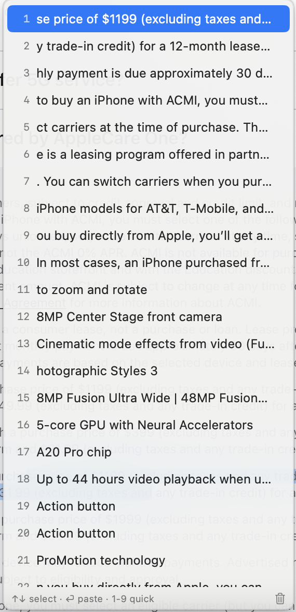
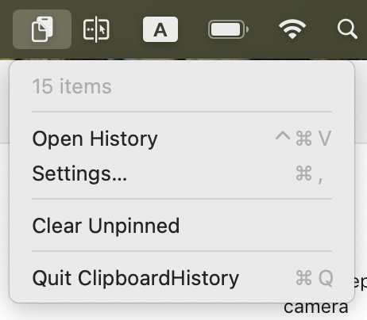
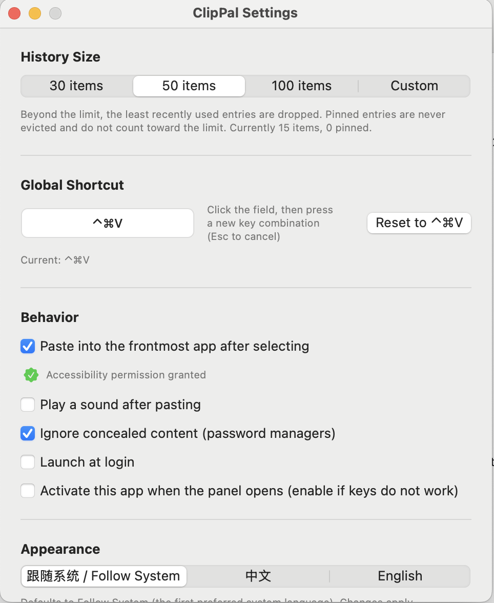

# ClipPal 安装与使用

一款常驻 macOS 菜单栏的剪贴板历史工具。

---

## 1. 安装

1. 下载 `ClipPal.dmg`。
2. 双击打开，把 **ClipPal** 图标拖进 **Applications** 文件夹。
3. 在 Finder 侧边栏弹出磁盘映像，安装完成。

---

## 2. 首次打开（重要）

因为 ClipPal 是个人开发的应用，macOS 第一次会拦截：

1. 打开 **访达 → 应用程序**。
2. **右键点击 ClipPal**，选择 **「打开」**。
3. 如果仍提示"无法验证开发者"，去 **系统设置 → 隐私与安全性**，在底部点击 **「仍要打开」**，输入密码即可。

> 这一步只需做一次，以后双击就能正常打开。

---

## 3. 授予辅助功能权限（实现自动粘贴）

1. 打开 **系统设置 → 隐私与安全性 → 辅助功能**。
2. 在列表里找到 **ClipPal**，打开开关。
3. 如果找不到，点左下角 **「+」**，从「应用程序」里添加 ClipPal。
4. 授权后建议重启一次 ClipPal（菜单栏图标 → 退出，再打开）。

> 没有这个权限，点击历史记录只会复制到剪贴板，需要你手动按 `⌘V`。有权限就能全自动粘贴。

---

## 4. 开始使用

按下默认快捷键 **`⌃⌘V`**（Control + Command + V）唤出历史面板。

| 操作 | 快捷键 |
| :--- | :--- |
| 上下选择 | `↑` `↓` |
| 粘贴选中项 | `⏎` |
| 快速粘贴第 N 条 | `⌘1` – `⌘9` |
| 删除选中项 | `⌘⌫` |
| 关闭面板 | `⎋` |
| 鼠标直接粘贴 | 单击某条记录 |

- **搜索**：唤出后直接打字过滤，忽略大小写和变音符号。
- **右键菜单**：可固定到顶部或删除。
- **自动去重**：重复复制同一内容只提到最前面，不会产生多条。
- **隐私保护**：默认忽略密码管理器标记为隐藏的内容。

---

## 5. 菜单栏与个性化设置

点击菜单栏图标，可以进行更多操作：

打开 **Settings...**，可以自由配置：

- 调整历史记录条数（30 / 50 / 100 / 自定义 5–500）
- 修改全局快捷键
- 开关自动粘贴、提示音、忽略隐藏内容
- 开启 **开机自启动**
- 切换界面语言（跟随系统 / 中文 / English）
- 调整面板透明度

---

## 常见问题

### 历史记录存在哪？

`~/Library/Containers/com.lipingweipersonalteam.ClipPal/Data/Library/Application Support/ClipPal/`

### 快捷键没反应？

可能和其他 App 冲突，去设置换一个组合键。

### 自动粘贴没生效？

检查 **系统设置 → 隐私与安全性 → 辅助功能** 里是否勾选了 ClipPal。

### 怎么彻底卸载？

退出 ClipPal，从「应用程序」删除，再删掉上面的数据文件夹，最后在 **系统设置 → 通用 → 登录项与扩展** 里删除 ClipPal。

---

© ClipPal · 剪贴伴侣
